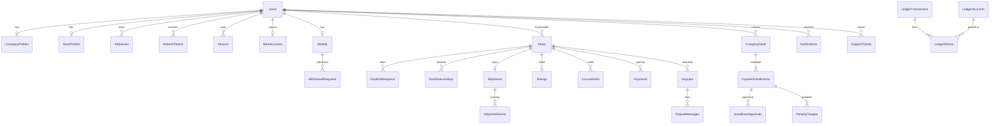

# اعتمد (Etamid): تصميم قاعدة البيانات الكامل

> **الإصدار:** مسودة 1 (20 أكتوبر 2026)
> **المرجع:** وثيقة المواصفات + عقد OpenAPI (78 عملية)
> **علامة ⚠️ العميل** = شيء ينتظر قراراً أو معلومة من العميل، وقد يغيّر أعمدة أو جداول.
> الجداول **55 جدولاً** في 9 مجموعات.

---

## 0) قواعد عامة تنطبق على كل الجداول

| القاعدة | التفصيل |
|---|---|
| المفتاح الأساسي | `Id bigint` (Identity). الأرقام التي يراها المستخدم (رقم المعاملة 45872، رقم النزاع D-45872، رقم التذكرة S-1021) أعمدة منفصلة من Sequences، وليست الـ `Id` |
| الأعمدة القياسية | `CreatedAt, UpdatedAt` (UTC). `DeletedAt` للحذف الناعم في الجداول التي تحتاجه فقط |
| المبالغ | `decimal(18,2)` دائماً بالريال، ولا نستخدم float أبداً |
| الأرقام والجوال | الجوال يُخزَّن موحداً `+9665XXXXXXXX` في `PhoneNormalized` |
| الحالات (Status) | تُخزَّن كنص قصير (enum كـ string) وليس رقماً، لتسهل القراءة والتقارير |
| الترجمة | القوائم الثابتة بعمودين `NameAr, NameEn` |
| التزامن | `RowVersion` (أو `xmin` في PostgreSQL) على جداول المال والمعاملات لمنع التعديل المتزامن |
| السجلات المالية | **لا تُعدَّل ولا تُحذف** (Append-only). التصحيح بقيد عكسي جديد |
| الملفات | لا نخزن ملفات في القاعدة. جدول `Files` يحمل المسار في التخزين، وباقي الجداول تشير له بـ `FileId` |
| الحذف | الحذف الناعم للمستخدمين فقط. المعاملات والمال لا تُحذف |
| قاعدة البيانات | أي من SQL Server أو PostgreSQL. الأنواع مكتوبة عامة |

---

## 1) خريطة العلاقات (مختصرة)



---

# المجموعة A: الهوية والحسابات (14 جدولاً)

## A1) `Users`
**ليه موجود:** الجدول الأساسي لكل شخص أو شركة تدخل التطبيق (فرد أو شركة). هو أصل كل العلاقات.

```
Id                    bigint PK
Code                  string(12) UNIQUE        -- كود البحث للبائع (يظهر في lookup)
Type                  enum: individual | company
Name                  string(150)              -- اسم المستخدم أو اسم الشركة
Phone                 string(20)               -- كما أدخله المستخدم
PhoneNormalized       string(15) UNIQUE        -- +9665XXXXXXXX
Email                 string(190) UNIQUE
PasswordHash          string(255)              -- Argon2id / BCrypt
Status                enum: pending_verification | active | suspended | deleted
PhoneVerifiedAt       datetime?
EmailVerifiedAt       datetime?                -- ⚠️ العميل: هل نتحقق من الإيميل؟
Language              enum: ar | en  (default ar)
AvatarFileId          bigint? FK Files
NafathVerified        bool                     -- نسخة مخزنة للسرعة، المصدر NafathVerifications
FailedLoginCount      int default 0
LockedUntil           datetime?                -- قفل الدخول المؤقت
LastLoginAt           datetime?
CreatedAt, UpdatedAt, DeletedAt?
```
**فهارس:** `PhoneNormalized` و`Email` و`Code` فريدة. فهرس على `Status`. استخدم **Filtered Unique Index** (حيث `DeletedAt IS NULL`) لو أردت السماح بإعادة استخدام رقم محذوف.

## A2) `CompanyProfiles`
**ليه موجود:** بيانات إضافية خاصة بالشركات فقط (سجل تجاري، ضريبي...). علاقة 1:1 مع `Users`.

```
UserId               bigint PK FK Users
CompanyName          string(200)
OwnerPhone           string(20)               -- جوال المالك (قد يساوي Users.Phone)
CommercialRegNo      string(30) UNIQUE
TaxNo                string(30)?              -- اختياري
ReviewStatus         enum: pending_review | approved | rejected
ReviewedByAdminId    bigint? FK AdminUsers
ReviewedAt           datetime?
RejectionReason      string(300)?
```
**ملاحظة:** الشركة لا تُنشئ معاملات قبل `approved` (من قرار دورة الـ Auth).

## A3) `StoreProfiles`
**ليه موجود:** «صفحة المتجر» (Mobile Shop: بانر، تصنيف، تقييم 4.9، 345 معاملة). أي مستخدم يبيع يحصل على متجر. القيم المحسوبة هنا مخزنة (Cache) لتسريع القراءة.

```
UserId               bigint PK FK Users
StoreName            string(150)
CategoryId           bigint? FK Lookups       -- نوع Lookups = store_category
BannerFileId         bigint? FK Files
RatingAvg            decimal(3,2) default 0   -- يُحدَّث عند كل تقييم
RatingCount          int default 0
SuccessfulDeals      int default 0            -- يُحدَّث عند اكتمال معاملة
```
⚠️ **العميل:** هل المتجر يُنشأ تلقائياً لكل مستخدم أم يطلبه البائع؟ وهل المتجر خاص بالأفراد فقط؟

## A4) `Addresses`
**ليه موجود:** عناوين الشحن (`shippingAddressId` في إنشاء المعاملة، وسطر «عنوان الشحن» في التفاصيل).

```
Id bigint PK, UserId bigint FK Users
Label            string(50)?              -- المنزل، العمل
RecipientName    string(150), RecipientPhone string(20)
City             string(80), District string(80)?, Street string(150)?
BuildingNo       string(20)?, PostalCode string(10)?, AdditionalNo string(10)?
FullText         string(300)              -- مثال: 3161-3203 Aram, Riyadh 12582
Latitude/Longitude  decimal?
IsDefault        bool
DeletedAt?
```
**مهم:** عند إنشاء المعاملة ننسخ العنوان كنص داخل `Deals.ShippingAddressSnapshot` حتى لا يتغير بعد تعديل العنوان.
⚠️ **العميل:** هل نستخدم عنوان وطني سعودي (National Address) كامل؟ لا توجد شاشة لإدخال العناوين في التصميم الحالي.

## A5) `OtpCodes`
**ليه موجود:** أكواد التحقق (تفعيل الحساب، استرداد كلمة المرور). نخزنها مشفّرة ونتتبع المحاولات.

```
Id bigint PK
PhoneNormalized   string(15)    -- وليس UserId، لأن الحساب قد لا يكتمل
UserId            bigint? FK Users
Purpose           enum: register | password_reset
CodeHash          string(255)
ExpiresAt         datetime
Attempts          int default 0          -- أقصى 5
SentCount         int                    -- لمعرفة حدود الإرسال
ConsumedAt        datetime?
CreatedAt
```
**فهارس:** `(PhoneNormalized, Purpose, CreatedAt DESC)` لحساب حدود الساعة واليوم.

## A6) `PasswordResetTokens`
**ليه موجود:** `resetToken` الذي يُمنح بعد نجاح خطوة التحقق (استخدام واحد، 10 دقائق).

```
Id bigint PK, UserId FK Users
TokenHash   string(255) UNIQUE
ExpiresAt   datetime
UsedAt      datetime?
CreatedAt, CreatedIp string(45)
```

## A7) `RefreshTokens`
**ليه موجود:** جلسات الدخول. كل جهاز له سلسلة (Family) لكشف سرقة التوكن عند إعادة استخدام توكن قديم.

```
Id bigint PK, UserId FK Users
TokenHash     string(255) UNIQUE
FamilyId      uniqueidentifier           -- كل التجديدات المتتالية لنفس الجلسة
DeviceId      bigint? FK Devices
ExpiresAt     datetime
RevokedAt     datetime?, RevokedReason string(40)? -- logout | rotated | reuse_detected | password_changed
ReplacedByTokenId bigint?
CreatedAt, CreatedIp string(45), UserAgent string(300)?
```
**فهارس:** `UserId`, `FamilyId`, `TokenHash`.

## A8) `Devices`
**ليه موجود:** توكنات FCM/APNs لإرسال Push، وربط الجلسة بالجهاز.

```
Id bigint PK, UserId FK Users
DeviceToken  string(500) UNIQUE
Platform     enum: android | ios
AppVersion   string(20)?, OsVersion string(20)?
LastSeenAt   datetime
IsActive     bool
```

## A9) `NafathVerifications`
**ليه موجود:** سجل محاولات التحقق من الهوية عبر نفاذ (الرقم العشوائي، الحالة).

```
Id bigint PK, UserId FK Users
RequestId       string(100) UNIQUE        -- من نفاذ
RandomNumber    string(4)
Status          enum: pending | verified | rejected | expired
NationalIdHash  string(255)?              -- لا نخزن الرقم الوطني خاماً
VerifiedName    string(150)?
ExpiresAt, CompletedAt?, CreatedAt
```
⚠️ **العميل:** ماذا نخزن بعد النجاح؟ (الاسم الرسمي؟ الرقم الوطني مشفّراً؟) ومتطلبات PDPL.

## A10) `Banks`
**ليه موجود:** قائمة البنوك (اسم وشعار)، نستنتج منها البنك من كود الـ IBAN.

```
Id bigint PK, Code string(4) UNIQUE   -- كود البنك داخل الـ IBAN (مثل 80 للراجحي)
NameAr, NameEn, LogoFileId bigint?, IsActive bool
```

## A11) `BankAccounts`
**ليه موجود:** حساب المستخدم البنكي لتحويل السحوبات.

```
Id bigint PK, UserId bigint UNIQUE FK Users      -- حساب واحد لكل مستخدم حالياً
HolderName   string(150)
IbanEncrypted  varbinary/string                  -- مشفّر
IbanLast4      string(4)                         -- للعرض المقنّع
IbanHash       string(64)                        -- لمنع تكرار نفس الـ IBAN ولبحث سريع
BankId       bigint FK Banks
VerifiedAt   datetime?
UpdatedAt
```
⚠️ **العميل:** هل يُسمح بأكثر من حساب بنكي؟ وهل يجب أن يطابق اسم صاحب الحساب اسم المستخدم الموثّق؟

## A12) `TermsVersions`
**ليه موجود:** نصوص الشروط والأحكام بإصدارات (منصة، معاملة، شركات).

```
Id bigint PK
Type        enum: platform | deal | company
Version     string(10)
TitleAr, TitleEn
ItemsAr     json/text, ItemsEn json/text         -- قائمة البنود
PublishedAt datetime, IsActive bool
UNIQUE (Type, Version)
```

## A13) `TermsAcceptances`
**ليه موجود:** دليل قانوني أن المستخدم وافق على إصدار معين، في أي وقت ومن أي جهاز.

```
Id bigint PK, UserId FK Users
TermsVersionId FK TermsVersions
DealId bigint? FK Deals, CompanyDealId bigint? FK CompanyDeals   -- عند الموافقة على شروط معاملة
AcceptedAt datetime, Ip string(45), DeviceId bigint?
```

## A14) `AuthAuditLogs`
**ليه موجود:** سجل أمني لكل حدث دخول (نجاح، فشل، قفل، تغيير كلمة مرور، تفعيل)، للتحقيق والكشف عن الهجمات.

```
Id bigint PK
UserId bigint?, PhoneNormalized string(15)?
Event   enum: login_success | login_failed | account_locked | otp_sent | otp_verified | otp_failed
        | password_reset | password_changed | token_reuse_detected | logout | logout_all
Ip string(45), UserAgent string(300)?, DeviceId bigint?
Details json?, CreatedAt
```
**فهارس:** `(UserId, CreatedAt)`, `(PhoneNormalized, CreatedAt)`, `(Ip, CreatedAt)`.

---

# المجموعة B: الإعدادات والمحتوى (4 جداول)

## B1) `AppSettings`
**ليه موجود:** إعدادات يغيّرها الأدمن بدون إصدار جديد (الحد الأدنى للإصدار، واتساب الدعم، مدد الانتظار، حدود المبالغ).

```
Key string(100) PK
Value string(1000)
ValueType enum: string | int | decimal | bool | json
Description string(300)?, UpdatedAt, UpdatedByAdminId bigint?
```
**أمثلة مفاتيح:** `min_version_android`, `min_version_ios`, `force_update`, `support_whatsapp`, `otp_expiry_seconds`, `deal_min_amount`, `deal_max_amount`, `withdraw_min_amount`, `auto_release_hours` ⚠️ العميل.

## B2) `Lookups`
**ليه موجود:** جدول واحد عام لكل القوائم الثابتة الصغيرة بدلاً من جدول لكل قائمة (`/lookups/{type}`).

```
Id bigint PK
Type    string(40)   -- reject_reason | dispute_reason | company_reject_reason
                     -- | duration_unit | payment_method | store_category | support_subject
Code    string(40)   -- ثابت للبرمجة
NameAr, NameEn string(150)
IconFileId bigint?, SortOrder int, IsActive bool
UNIQUE (Type, Code)
```
⚠️ **العميل:** أسباب الرفض الستة وأسباب النزاع الستة نصوصها النهائية، ووسائل الدفع المعتمدة.

## B3) `ShippingCompanies`
**ليه موجود:** شركات الشحن (أرامكس...). مستقلة لأن لها بيانات تكامل (كود الخدمة، الرسوم).

```
Id bigint PK, Code string(30) UNIQUE
NameAr, NameEn, LogoFileId bigint?
IntegrationType enum: aramex | manual
IsActive bool, SortOrder int
```
⚠️ **العميل:** من يدفع تكلفة الشحن؟ وهل تُحسب داخل قيمة المعاملة أم منفصلة؟

## B4) `Faqs`
**ليه موجود:** الأسئلة الشائعة التي يديرها الأدمن.

```
Id bigint PK
QuestionAr, QuestionEn string(300)
AnswerAr, AnswerEn text
SortOrder int, IsActive bool, UpdatedAt
```

---

# المجموعة C: الملفات (1 جدول)

## C1) `Files`
**ليه موجود:** مكان واحد لكل مرفق (صور، عقود، مستندات نزاع، بنرات)، مع فحص النوع والحجم والمالك. أي جدول يحتاج ملفاً يشير له.

```
Id bigint PK, PublicId uniqueidentifier UNIQUE   -- الذي يرجع للموبايل كـ fileId
OwnerUserId bigint? FK Users
Purpose   enum: avatar | store_banner | deal_image | dispute | contract | support | other
StorageKey string(300)          -- المسار في S3/Blob
FileName string(200), ContentType string(100), SizeBytes bigint
Sha256 string(64)?              -- لكشف التكرار والتلاعب
Status  enum: uploaded | attached | quarantined | deleted
CreatedAt
```
**ملاحظة:** الملف الذي لم يُربَط بكيان خلال 24 ساعة يُحذف بمهمة خلفية.

---

# المجموعة D: معاملات الأفراد (5 جداول)

## D1) `Deals`
**ليه موجود:** قلب النظام. كل معاملة بين مشترٍ وبائع بكل بياناتها وحالتها.

```
Id bigint PK
Number            bigint UNIQUE            -- 45872 (من Sequence، يظهر للمستخدمين)
BuyerId           bigint FK Users
SellerId          bigint FK Users          -- CHECK (BuyerId <> SellerId)
Title             string(150)
Description       string(200)
Amount            decimal(18,2)            -- القيمة الحالية (تتغير بعد التعديلات المقبولة)
OriginalAmount    decimal(18,2)            -- للأرشفة
Currency          char(3) default 'SAR'
DurationValue     int
DurationUnit      enum: hour | day
Status            enum: draft | pending_seller | edit_proposed | pending_buyer_approval | accepted
                  | funded | shipped | delivered | completed | rejected | disputed | refunded
                  | expired | cancelled
NeedShipping      bool
ShippingCompanyId bigint? FK ShippingCompanies
ShippingAddressId bigint? FK Addresses
ShippingAddressSnapshot string(400)?       -- نسخة نصية ثابتة
PaymentMethodCode string(30)?              -- apple_pay | mada | card | wallet
ImageFileId       bigint? FK Files         -- صورة المنتج
RejectReasonId    bigint? FK Lookups, RejectNote string(200)?
RespondDeadlineAt datetime                 -- مهلة رد البائع (لـ Expire)
AcceptedAt, FundedAt, ShippedAt, DeliveredAt, CompletedAt, ExpiresAt   -- datetime?
FeeAmount         decimal(18,2)?           -- ⚠️ العميل: العمولة
SellerNetAmount   decimal(18,2)?
IsDisputed        bool
RowVersion
CreatedAt, UpdatedAt
```
**فهارس:** `Number` فريد. `(BuyerId, Status)`, `(SellerId, Status)`, `(Status, ExpiresAt)` لمهام الانتهاء.
**ملاحظة:** حقل `badge` (3 أيام / 6 ساعات) لا يُخزَّن، بل يُحسب من `ExpiresAt`.
⚠️ **العميل:** متى يبدأ العد التنازلي للمدة (من القبول، أم من الدفع، أم من الشحن)؟ وهل يتأثر `ExpiresAt` بالتعديلات؟

## D2) `DealEditRequests`
**ليه موجود:** تعديلات البائع المقترحة، نحتفظ بالقيم **قبل وبعد** لتعرض شاشة المقارنة، ولسجل كامل لو تكررت التعديلات.

```
Id bigint PK, DealId FK Deals
ProposedById bigint FK Users
PrevAmount decimal(18,2), PrevDurationValue int, PrevDurationUnit string, PrevDescription string(200)
NewAmount decimal(18,2)?, NewDurationValue int?, NewDurationUnit string?, NewDescription string(200)?
Status enum: pending | approved | rejected | cancelled
RespondedAt datetime?, RespondedById bigint?
CreatedAt
```
**قيد:** تعديل واحد `pending` فقط لكل معاملة.

## D3) `DealStatusHistory`
**ليه موجود:** سجل الحالات (`/deals/{id}/timeline`)، ودليل تدقيق من فعل ماذا ومتى.

```
Id bigint PK, DealId FK Deals
FromStatus string(30)?, ToStatus string(30)
ActorUserId bigint?, ActorType enum: buyer | seller | system | admin
Note string(300)?, CreatedAt
```
**فهرس:** `(DealId, CreatedAt)`.

## D4) `Shipments` و `ShipmentEvents`
**ليه موجود:** الشحنة وتتبعها (أرامكس).

```
Shipments:
Id bigint PK, DealId bigint UNIQUE FK Deals
ShippingCompanyId FK ShippingCompanies
TrackingNumber string(60)?, WaybillFileId bigint? (بوليصة PDF)
Status enum: created | picked_up | in_transit | out_for_delivery | delivered | failed | returned
ProviderPayload json?, LastSyncedAt datetime?
CreatedAt, UpdatedAt

ShipmentEvents:
Id bigint PK, ShipmentId FK Shipments
EventAt datetime, Code string(40), Description string(300), Location string(100)?
UNIQUE (ShipmentId, EventAt, Code)    -- لمنع تكرار الأحداث عند المزامنة
```

## D5) `Ratings`
**ليه موجود:** تقييم المشتري للبائع بعد الاكتمال، وتُشتق منه صفحة المتجر.

```
Id bigint PK, DealId bigint UNIQUE FK Deals     -- تقييم واحد لكل معاملة
RaterId FK Users, SellerId FK Users
Stars tinyint CHECK (1..5), Comment string(300)?
IsVisible bool default true                     -- للإخفاء من الأدمن
CreatedAt
```
**فهرس:** `(SellerId, CreatedAt DESC)`.
⚠️ **العميل:** هل يقيّم البائع المشتري أيضاً؟ وهل يرد البائع على التقييم؟

---

# المجموعة E: المال (9 جداول): الأهم والأكثر حساسية

**المبدأ:** كل حركة مال تُسجَّل كـ **قيد مزدوج** (مدين = دائن). الأرصدة المعروضة مخزنة للسرعة لكن **المصدر الحقيقي هو الدفتر**، وأي فرق بينهما يعني خللاً.

## E1) `Wallets`
**ليه موجود:** محفظة المستخدم (تفعيلها، الرصيد المتاح).

```
Id bigint PK, UserId bigint UNIQUE FK Users
LedgerAccountId bigint FK LedgerAccounts
Activated        bool                    -- ⚠️ العميل: شروط التفعيل
ActivatedAt      datetime?
AvailableBalance decimal(18,2) default 0 CHECK (>= 0)   -- مخزن، مصدره الدفتر
RowVersion
```
**ملاحظة:** `heldAmount` الذي يراه المستخدم = مجموع `EscrowHolds` النشطة المرتبطة به، وليس عموداً هنا.

## E2) `LedgerAccounts`
**ليه موجود:** حسابات الدفتر. لكل محفظة حساب، وللمنصة حسابات نظامية.

```
Id bigint PK
Type  enum: user_wallet | platform_escrow | platform_revenue | gateway_clearing | bank_payout | penalty_income
OwnerUserId bigint? FK Users            -- فقط في user_wallet
Currency char(3) default 'SAR'
```

## E3) `LedgerTransactions`
**ليه موجود:** رأس العملية المالية (سبب الحركة).

```
Id bigint PK, PublicId uniqueidentifier UNIQUE
Type  enum: escrow_funding | escrow_release | escrow_refund | withdrawal | fee | penalty | adjustment
DealId bigint?, CompanyDealId bigint?, InstallmentId bigint?, WithdrawalId bigint?, PaymentId bigint?
Description string(300)
IdempotencyKey string(64)? UNIQUE
CreatedByType enum: user | system | admin, CreatedById bigint?
CreatedAt
```

## E4) `LedgerEntries`
**ليه موجود:** سطور القيد. كل `LedgerTransaction` له سطران أو أكثر، ومجموع المدين = مجموع الدائن.

```
Id bigint PK, TransactionId FK LedgerTransactions
AccountId FK LedgerAccounts
Direction enum: debit | credit
Amount decimal(18,2) CHECK (> 0)
BalanceAfter decimal(18,2)?             -- لحساب المحفظة فقط، لعرض السجل بسرعة
CreatedAt
```
**هذا الجدول يغذي «سجل التحويلات» في المحفظة** (Paid, Refund...).
**قيد:** Append-only. لا UPDATE ولا DELETE (يُمنع بصلاحيات القاعدة أو Trigger).

**أمثلة قيود:**
| الحدث | المدين | الدائن |
|---|---|---|
| المشتري دفع 6200 | gateway_clearing 6200 | platform_escrow 6200 |
| تأكيد الاستلام (عمولة 100) | platform_escrow 6200 | seller_wallet 6100 + platform_revenue 100 |
| استرداد للمشتري | platform_escrow 6200 | gateway_clearing 6200 (ثم رد عبر البوابة) |
| سحب 1000 | seller_wallet 1000 | bank_payout 1000 |

## E5) `EscrowHolds`
**ليه موجود:** حجز المبلغ لكل معاملة، بحالته (محجوز، محرَّر، مسترد)، وهو الذي يُحسب منه `heldAmount` وشارة «المبلغ محجوز».

```
Id bigint PK, DealId bigint UNIQUE FK Deals
BuyerId FK Users, SellerId FK Users
Amount decimal(18,2), FeeAmount decimal(18,2)?
Status enum: held | released | refunded | frozen_dispute
PaymentId FK Payments
HeldAt, ReleasedAt?, RefundedAt?, ReleaseReason enum: buyer_confirmed | auto_release | dispute_seller | dispute_buyer
RowVersion
```
⚠️ **العميل:** هل نسمح بتحرير جزئي (استرداد جزء من المبلغ في نزاع)؟ هذا يغير `Status` وإمكانية أكثر من تحرير للحجز الواحد.

## E6) `Payments`
**ليه موجود:** عمليات الدفع عبر البوابة (Apple Pay، mada، بطاقة)، بحالة كل محاولة.

```
Id bigint PK, PublicId uniqueidentifier UNIQUE
UserId FK Users, DealId bigint? FK Deals, InstallmentId bigint? FK PaymentInstallments
Method enum: apple_pay | mada | card | wallet | bank_transfer
Amount decimal(18,2), Currency char(3)
Status enum: initiated | requires_action | succeeded | failed | refunded | partially_refunded
Provider string(30), ProviderPaymentId string(100)? UNIQUE, ProviderPayload json?
FailureCode string(50)?, FailureMessage string(300)?
IdempotencyKey string(64) UNIQUE
CreatedAt, UpdatedAt
```
⚠️ **العميل:** اسم البوابة. وهل الاسترداد يعود للبطاقة أم للمحفظة؟

## E7) `PaymentWebhookEvents`
**ليه موجود:** تسجيل كل إشعار من البوابة، وتجاهل المكرر، وإمكانية إعادة المعالجة عند الفشل.

```
Id bigint PK
Provider string(30), ProviderEventId string(100)    -- UNIQUE (Provider, ProviderEventId)
EventType string(60), Payload json, SignatureValid bool
Status enum: received | processed | failed | ignored
ProcessedAt datetime?, Error string(500)?, Attempts int
ReceivedAt
```

## E8) `WithdrawalRequests`
**ليه موجود:** طلبات سحب الرصيد إلى البنك ودورة موافقتها.

```
Id bigint PK, UserId FK Users, WalletId FK Wallets
BankAccountId FK BankAccounts
IbanSnapshotMasked string(34)
Amount decimal(18,2), FeeAmount decimal(18,2) default 0
Status enum: pending | approved | processing | completed | rejected | failed
RejectionReason string(300)?
ApprovedByAdminId bigint?, ApprovedAt?, ProcessedAt?, BankReference string(60)?
IdempotencyKey string(64) UNIQUE
CreatedAt
```
⚠️ **العميل:** هل السحب تلقائي أم يحتاج موافقة الأدمن؟ حد أدنى/أقصى؟ ومدة التحويل؟

## E9) `IdempotencyKeys`
**ليه موجود:** حماية endpoints المال (`/pay`, `/withdraw`) من التكرار، ونرجع **نفس الرد** لنفس المفتاح.

```
Key string(64)  UserId bigint   -- PK مركّب (UserId, Key)
RequestHash string(64)          -- لكشف استخدام نفس المفتاح بطلب مختلف
Endpoint string(100)
ResponseStatus int, ResponseBody text
CreatedAt, ExpiresAt            -- تنظيف بعد 24 ساعة
```

> **جدول `FeeRules` (قواعد العمولة)** مؤجل: ⚠️ **العميل.** إذا كانت العمولة نسبة ثابتة نكتفي بـ `AppSettings`، وإذا كانت شرائح أو تختلف بين الأفراد والشركات ننشئ جدول `FeeRules(Type, MinAmount, MaxAmount, Percent, Fixed, PaidBy)`.

---

# المجموعة F: النزاعات والدعم (5 جداول)

## F1) `Disputes`
**ليه موجود:** النزاع المفتوح على معاملة، وحالته وقرار الإدارة.

```
Id bigint PK
Number          string(20) UNIQUE        -- D-45872
DealId          bigint FK Deals
OpenedById      bigint FK Users, AgainstUserId bigint FK Users
ReasonId        bigint FK Lookups        -- dispute_reason
Details         string(200)
Status          enum: under_review | awaiting_info | resolved_buyer | resolved_seller | closed
Resolution      enum: refund_buyer | release_seller | partial | none     -- ⚠️ partial: العميل
ResolutionNote  string(500)?, ResolvedByAdminId bigint?, ResolvedAt datetime?
AssignedAdminId bigint?
RowVersion, CreatedAt, UpdatedAt
```
**قيد:** نزاع واحد غير مغلق لكل معاملة (Filtered Unique Index على `DealId` حيث `Status` ليست resolved/closed).

## F2) `DisputeMessages`
**ليه موجود:** محادثة النزاع بين الطرفين والإدارة (طلب مستندات إضافية).

```
Id bigint PK, DisputeId FK Disputes
SenderType enum: buyer | seller | admin, SenderUserId bigint?, SenderAdminId bigint?
Message text?, IsInternalNote bool        -- ملاحظات خاصة بالإدارة لا يراها الطرفان
CreatedAt
```

## F3) `DisputeAttachments`
**ليه موجود:** الملفات المرفقة (حتى 5 عند الفتح، وأخرى لاحقاً)، وربط الملف بالنزاع أو برسالة.

```
Id bigint PK, DisputeId FK Disputes, MessageId bigint? FK DisputeMessages
FileId FK Files, UploadedByUserId bigint?, CreatedAt
```
**قيد:** حد 5 ملفات عند الفتح يُتحقق منه في التطبيق.

## F4) `SupportTickets`
**ليه موجود:** تذاكر «تواصل معنا» و«طلبات الدعم».

```
Id bigint PK, Number string(20) UNIQUE   -- S-1021
UserId FK Users, DealId bigint? FK Deals
SubjectId bigint? FK Lookups, Subject string(200), Message text
Status enum: open | in_review | closed
AssignedAdminId bigint?, ClosedAt?, CreatedAt, UpdatedAt
```

## F5) `SupportTicketMessages`
**ليه موجود:** الردود داخل التذكرة. ⚠️ مطلوب إذا أضفنا `GET /support/tickets/{id}`.

```
Id bigint PK, TicketId FK SupportTickets
SenderType enum: user | admin, SenderUserId bigint?, SenderAdminId bigint?
Message text, FileId bigint?, CreatedAt
```

---

# المجموعة G: معاملات الشركات (5 جداول)

> ⚠️ **العميل (أهم أسئلة هذه المجموعة):** من الدافع ومن المستلم؟ وهل الطرف الآخر مستخدم مسجل بالتطبيق أم مجرد اسم؟ لذلك أضفت `CounterpartyUserId` اختيارياً بجانب الاسم والجوال.

## G1) `CompanyDeals`
**ليه موجود:** معاملة الشركة الكبيرة. وتخدم **المسودة والمعاملة الفعلية** (الحالة `draft` أثناء المعالج، فلا نحتاج جدولاً منفصلاً للمسودات).

```
Id bigint PK
Number            bigint UNIQUE            -- 45872
CreatorUserId     bigint FK Users          -- الشركة المنشئة
CounterpartyUserId bigint? FK Users        -- الطرف الآخر إن كان مسجلاً  ⚠️
CounterpartyName  string(200), CounterpartyPhone string(20)
Title             string(150), Details string(200)
TotalAmount       decimal(18,2), Currency char(3) default 'SAR'
StartDate         date
ContractFileId    bigint? FK Files
-- الخطوة 3: إعدادات اعتماد الدفعات
ApprovalSendDaysBefore  int?, ApprovalResponseDays int?, ApprovalNotes string(200)?
-- الخطوة 4: الشرط الجزائي
PenaltyPercent    decimal(5,2)?, PenaltyGraceDays int default 30, PenaltyClauses string(200)?
WizardStep        tinyint                  -- آخر خطوة أُكملت (للمسودة)
Status            enum: draft | pending | active | completed | rejected | cancelled
RejectReasonId    bigint? FK Lookups, RejectNote string(200)?
SubmittedAt, AcceptedAt, CompletedAt  datetime?
RowVersion, CreatedAt, UpdatedAt
```
**ملاحظة:** وضعت إعدادات الاعتماد والشرط الجزائي كأعمدة هنا (علاقة 1:1) بدل جدولين منفصلين لتبسيط الاستعلامات. إذا احتجنا شروطاً متعددة لكل معاملة نحوّلها لجدول `PenaltyClauses`.

## G2) `CompanyDealStatusHistory`
**ليه موجود:** نفس فكرة سجل حالات المعاملات الفردية، لتتبع تاريخ المعاملة.

```
Id bigint PK, CompanyDealId FK CompanyDeals
FromStatus, ToStatus string(30), ActorUserId bigint?, ActorType enum, Note string(300)?, CreatedAt
```

## G3) `PaymentInstallments`
**ليه موجود:** جدول الدفعات (الأولى، الثانية...) وحالة كل دفعة.

```
Id bigint PK, CompanyDealId FK CompanyDeals
Order tinyint                             -- 1,2,3..
Label string(50)?                         -- يُولَّد "الدفعة الأولى"
Amount decimal(18,2) CHECK (> 0)
DueDate date
Status enum: scheduled | awaiting_approval | approved | rejected | paid | overdue | penalty_applied
ApprovalRequestedAt datetime?, ApprovalDeadlineAt datetime?
ApprovedAt?, PaidAt?, PaymentId bigint? FK Payments
Notes string(200)?
RowVersion
UNIQUE (CompanyDealId, Order)
```
**قاعدة تحقق (في التطبيق):** `SUM(Amount) = CompanyDeals.TotalAmount` عند `submit`.
**فهرس:** `(Status, DueDate)` لمهام الاستحقاق والشرط الجزائي.

## G3b) `InstallmentApprovals`
**ليه موجود:** سجل قرارات الاعتماد/الرفض لكل دفعة (قد تُرفض ثم تُعاد).

```
Id bigint PK, InstallmentId FK PaymentInstallments
DecidedByUserId FK Users
Decision enum: approved | rejected
Reason string(200)?          -- مطلوب عند الرفض
DecidedAt
```

## G4) `PenaltyCharges`
**ليه موجود:** الغرامات التي طُبّقت فعلاً على دفعات متأخرة (المبلغ، السبب، وقت التطبيق)، وتتحول لقيد مالي.

```
Id bigint PK, InstallmentId FK PaymentInstallments, CompanyDealId FK CompanyDeals
PenaltyPercent decimal(5,2), BaseAmount decimal(18,2), PenaltyAmount decimal(18,2)
DaysLate int, AppliedAt datetime
LedgerTransactionId bigint? FK LedgerTransactions
Status enum: applied | waived | paid        -- waived: إعفاء من الأدمن
WaivedByAdminId bigint?, WaiverReason string(300)?
```
**قيد:** غرامة واحدة فقط لكل دفعة (UNIQUE على `InstallmentId`) إلا إذا كانت الغرامة تتكرر دورياً ⚠️ العميل.

---

# المجموعة H: الإشعارات والتواصل (4 جداول)

## H1) `Notifications`
**ليه موجود:** صندوق الإشعارات داخل التطبيق (الجرس).

```
Id bigint PK, UserId FK Users
Type enum: deal_request | deal_accepted | deal_rejected | deal_edit | deal_funded | deal_shipped
         | deal_delivered | dispute_update | payment_approval | payment_due | penalty | wallet | system
TitleAr, TitleEn string(150), BodyAr, BodyEn string(500)   -- أو عنوان واحد مترجم عند الإنشاء بلغة المستخدم
DealId bigint?, CompanyDealId bigint?, InstallmentId bigint?, DisputeId bigint?
Data json?                                -- أي حمولة إضافية لفتح الشاشة
IsRead bool, ReadAt datetime?, PushSentAt datetime?
CreatedAt
```
**فهرس:** `(UserId, IsRead, CreatedAt DESC)`.

## H2) `NotificationTemplates`
**ليه موجود:** نصوص الإشعارات والرسائل SMS القابلة للتعديل من الأدمن بمتغيرات (`{dealNumber}`).

```
Id bigint PK, Code string(60) UNIQUE
Channel enum: push | sms | in_app
TitleAr, TitleEn, BodyAr, BodyEn
IsActive bool, UpdatedAt
```

## H3) `BroadcastCampaigns`
**ليه موجود:** الإشعارات الجماعية من لوحة الإدارة (إعلان، صيانة...).

```
Id bigint PK, TitleAr/En, BodyAr/En
AudienceFilter json          -- كل المستخدمين / أفراد / شركات / ...
Status enum: draft | scheduled | sending | sent | cancelled
ScheduledAt?, SentAt?, RecipientsCount int
CreatedByAdminId bigint, CreatedAt
```

## H4) `SmsLogs`
**ليه موجود:** سجل الرسائل المرسلة (OTP وغيرها) لمعرفة التكلفة والمشاكل ومطابقة الفواتير مع المزود.

```
Id bigint PK, PhoneNormalized string(15), Purpose string(40)
Provider string(30), ProviderMessageId string(100)?
Status enum: queued | sent | delivered | failed
Error string(300)?, Cost decimal(10,4)?, CreatedAt
```
**لا نخزن نص الـ OTP هنا.**

---

# المجموعة I: لوحة الإدارة والنظام (7 جداول)

## I1) `AdminUsers`
**ليه موجود:** مستخدمو لوحة Angular. **منفصلون عن `Users`** بمصادقة وصلاحيات مستقلة (أمان أعلى، 2FA).

```
Id bigint PK, Name, Email UNIQUE, PasswordHash
TwoFactorEnabled bool, TwoFactorSecret string?(مشفّر)
Status enum: active | disabled
FailedLoginCount, LockedUntil?, LastLoginAt?
CreatedAt, UpdatedAt
```

## I2) `AdminRoles` / I3) `AdminPermissions` / I4) `AdminRolePermissions` / I5) `AdminUserRoles`
**ليه موجودة:** نظام صلاحيات (RBAC): دور مثل «مراجع نزاعات» له صلاحيات مثل `disputes.resolve`, `withdrawals.approve`, `users.suspend`.

```
AdminRoles:           Id, Name UNIQUE, Description
AdminPermissions:     Id, Code UNIQUE (مثل disputes.resolve), Description
AdminRolePermissions: RoleId, PermissionId       -- PK مركّب
AdminUserRoles:       AdminUserId, RoleId        -- PK مركّب
```

## I6) `AuditLogs`
**ليه موجود:** سجل تدقيق لكل عمل إداري أو حساس (حسم نزاع، اعتماد سحب، إيقاف مستخدم، تعديل إعدادات). مختلف عن `AuthAuditLogs` الخاص بالدخول.

```
Id bigint PK
ActorType enum: admin | user | system, ActorId bigint?
Action string(80)               -- dispute.resolved, withdrawal.approved ...
EntityType string(50), EntityId bigint
OldValues json?, NewValues json?
Ip string(45), CreatedAt
```
**فهارس:** `(EntityType, EntityId)`, `(ActorType, ActorId, CreatedAt)`.

## I7) `OutboxMessages`
**ليه موجود:** ضمان وصول الإشعارات والأحداث بعد نجاح المعاملة المالية (Outbox Pattern). نكتب الحدث في نفس معاملة القاعدة، ثم مهمة خلفية ترسله.

```
Id bigint PK, Type string(80), Payload json
Status enum: pending | processed | failed
Attempts int, NextAttemptAt datetime?, ProcessedAt datetime?, Error string(500)?
CreatedAt
```
**ملاحظة:** جداول Hangfire تُنشأ تلقائياً في schema منفصل (`hangfire`).

---

# الملخص

| المجموعة | الجداول | العدد |
|---|---|---|
| A: الهوية | Users, CompanyProfiles, StoreProfiles, Addresses, OtpCodes, PasswordResetTokens, RefreshTokens, Devices, NafathVerifications, Banks, BankAccounts, TermsVersions, TermsAcceptances, AuthAuditLogs | 14 |
| B: الإعدادات | AppSettings, Lookups, ShippingCompanies, Faqs | 4 |
| C: الملفات | Files | 1 |
| D: معاملات الأفراد | Deals, DealEditRequests, DealStatusHistory, Shipments, ShipmentEvents, Ratings | 6 |
| E: المال | Wallets, LedgerAccounts, LedgerTransactions, LedgerEntries, EscrowHolds, Payments, PaymentWebhookEvents, WithdrawalRequests, IdempotencyKeys | 9 |
| F: النزاعات والدعم | Disputes, DisputeMessages, DisputeAttachments, SupportTickets, SupportTicketMessages | 5 |
| G: الشركات | CompanyDeals, CompanyDealStatusHistory, PaymentInstallments, InstallmentApprovals, PenaltyCharges | 5 |
| H: الإشعارات | Notifications, NotificationTemplates, BroadcastCampaigns, SmsLogs | 4 |
| I: الإدارة والنظام | AdminUsers, AdminRoles, AdminPermissions, AdminRolePermissions, AdminUserRoles, AuditLogs, OutboxMessages | 7 |
| **الإجمالي** | | **55** |

---

# ⚠️ قائمة ما ننتظره من العميل (وما يتأثر به)

| # | السؤال | الجداول والأعمدة المتأثرة |
|---|---|---|
| 1 | من يدفع ومن يستلم في معاملة الشركة؟ وهل الطرف الآخر مسجل؟ | `CompanyDeals.CounterpartyUserId`، وكيف تُسجَّل الدفعات في الدفتر (`Payments`, `LedgerEntries`) |
| 2 | العمولة: النسبة، من يدفعها، شرائح أم ثابتة؟ | `Deals.FeeAmount/SellerNetAmount`، `EscrowHolds.FeeAmount`، وجدول `FeeRules` المؤجل |
| 3 | متى يبدأ العد التنازلي للمدة؟ | `Deals.ExpiresAt`, `RespondDeadlineAt` |
| 4 | التحرير التلقائي للمبلغ إن لم يؤكد المشتري؟ | `AppSettings.auto_release_hours`، `EscrowHolds.ReleaseReason` |
| 5 | هل يوجد تحرير أو استرداد **جزئي** في النزاعات؟ | `EscrowHolds`, `Disputes.Resolution`، وقد نحتاج جدول `EscrowRelease` للتحريرات المتعددة |
| 6 | اسم بوابة الدفع وطريقة الاسترداد | `Payments`, `PaymentWebhookEvents`، حقول `Provider*` |
| 7 | وسائل الدفع (Apple Pay فقط أم mada وبطاقات وتحويل)؟ | `Payments.Method`، `Lookups(payment_method)` |
| 8 | السحب: تلقائي أم بموافقة؟ حدود؟ رسوم؟ | `WithdrawalRequests`, `AppSettings` |
| 9 | تفعيل المحفظة: ما الشروط (نفاذ؟ بنك؟)؟ | `Wallets.Activated`، المنطق في التطبيق |
| 10 | حساب بنكي واحد أم أكثر؟ مطابقة الاسم؟ | `BankAccounts` (UNIQUE على `UserId` أو لا) |
| 11 | المتجر: تلقائي لكل مستخدم؟ ومن يحدد التصنيف؟ | `StoreProfiles`, `Lookups(store_category)` |
| 12 | العناوين: عنوان وطني كامل؟ شاشة إدخال غير موجودة | `Addresses` |
| 13 | ما يُخزَّن بعد نفاذ (الاسم الرسمي، الهوية)؟ PDPL | `NafathVerifications`, `Users` |
| 14 | التحقق من الإيميل مطلوب؟ | `Users.EmailVerifiedAt` |
| 15 | الشرط الجزائي: مرة واحدة أم متكرر؟ وهل يُحصَّل من المحفظة؟ | `PenaltyCharges` (UNIQUE على `InstallmentId`) |
| 16 | هل يقيّم البائع المشتري؟ هل يرد على التقييم؟ | `Ratings` (+ `RatingReplies` إن لزم) |
| 17 | من يدفع الشحن؟ وهل تُنشأ البوليصة من المنصة؟ | `Deals`, `Shipments`, `ShippingCompanies` |
| 18 | نصوص أسباب الرفض والنزاع النهائية | `Lookups` (بيانات أولية Seed) |
| 19 | هل نحتاج Multi-currency؟ | نبقي `Currency` في الجداول، والمنطق SAR فقط حالياً |
| 20 | هل تُدعم **لغات إضافية** غير العربية والإنجليزية؟ | كل أعمدة `NameAr/NameEn`، وقد نتحول لجدول ترجمات |

---

# ترتيب الإنشاء (Migrations) حسب مراحل الخطة

| المرحلة | الجداول |
|---|---|
| 0–1: الحسابات | A (Users, CompanyProfiles, OtpCodes, PasswordResetTokens, RefreshTokens, Devices, TermsVersions, TermsAcceptances, AuthAuditLogs)، B (AppSettings, Lookups)، C (Files)، I (OutboxMessages) |
| 2: الملف والإشعارات | A (StoreProfiles, Addresses, NafathVerifications, Banks, BankAccounts)، B (Faqs)، H، F (SupportTickets + Messages) |
| 3: معاملات الأفراد | D (Deals, DealEditRequests, DealStatusHistory)، B (ShippingCompanies) |
| 4: المحفظة والدفع | E كاملة |
| 5: الشحن والتقييم | D (Shipments, ShipmentEvents, Ratings) |
| 6: النزاعات | F (Disputes, DisputeMessages, DisputeAttachments) |
| 7: الشركات | G كاملة |
| 8: لوحة الإدارة | I (AdminUsers, Roles, Permissions, AuditLogs)، H (BroadcastCampaigns) |

> **توصية:** المرحلة 0–1 تحتاج فقط الجداول الموجودة في الصف الأول. لا نبني الـ 55 دفعة واحدة، بل نضيف الجداول مع كل مرحلة، ما عدا **تصميم المال (المجموعة E) الذي نثبته نظرياً قبل البدء بالكود** لأن تغييره لاحقاً مكلف جداً.
